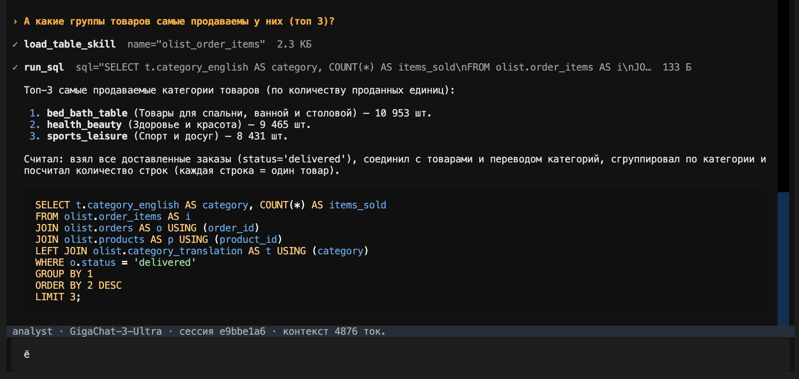

# analyst

Text-to-SQL агент: отвечает на вопросы по данным, сам пишет и выполняет SQL.

В промпте у него только каталог таблиц — по строке на таблицу. Что лежит в таблице,
как её соединять и где подвохи, он узнаёт из скилла таблицы, который загружает перед
запросом. Поэтому агент универсальный: новый датасет — это схема, CSV и скиллы, код
агента не меняется.

| Датасет | Схема | Что внутри |
| --- | --- | --- |
| [Olist](https://www.kaggle.com/datasets/olistbr/brazilian-ecommerce) | `olist` | бразильский маркетплейс: 99 тыс. заказов 2016–2018, товары, платежи, отзывы, 9 таблиц |
| [Formula 1](https://www.kaggle.com/datasets/rohanrao/formula-1-world-championship-1950-2020) | `f1` | все чемпионаты 1950–2024: гонки, пилоты, команды, круги, пит-стопы, 14 таблиц |

```bash
make analyst                      # скачать датасеты в data/ и установить агента
PG_AGENT_NAME=analyst make tui    # или make telegram с тем же PG_AGENT_NAME
```

Вопрос по Olist в TUI: агент загружает скилл `olist_order_items`, пишет запрос и
показывает его вместе с ответом.



## Как устроено

| Файл | Что там |
| --- | --- |
| `schema.sql` | роль `analyst_reader` и инструмент `run_sql` |
| `agent.sql` | инструменты `run_sql`, `load_table_skill`, каталог скиллов в промпте |
| `datasets/<имя>/install.sql` | таблицы, загрузка CSV, права на чтение, импорт скиллов |
| `datasets/<имя>/skills/*.md` | по скиллу на таблицу; первая строка front matter — описание для каталога |

`run_sql` выполняет запрос в отдельной сессии через `dblink`:

- от роли `analyst_reader`: у неё есть только `SELECT` на схемы датасетов, к `core.*` и
  функциям расширений (`pgsql-http`) доступа нет;
- сессия только для чтения, запрос обёрнут в подзапрос с `limit`;
- дедлайн 15 секунд держит сам `run_sql`: внутри хода `statement_timeout` не работает, а
  на удалённой стороне текст запроса мог бы его отключить.

## Новый датасет

1. Положить CSV в `data/<имя>/` и добавить загрузку в Makefile (`data`).
2. `datasets/<имя>/install.sql`: таблицы с ключами, `copy … from '/work/data/…'`,
   `grant select … to analyst_reader`, `select skills.import('analyst', …)`.
3. По скиллу на таблицу: что в ней, гранулярность строки, колонки, связи, подвохи и
   пример запроса. Пример должен выполняться — агент будет писать по нему.
